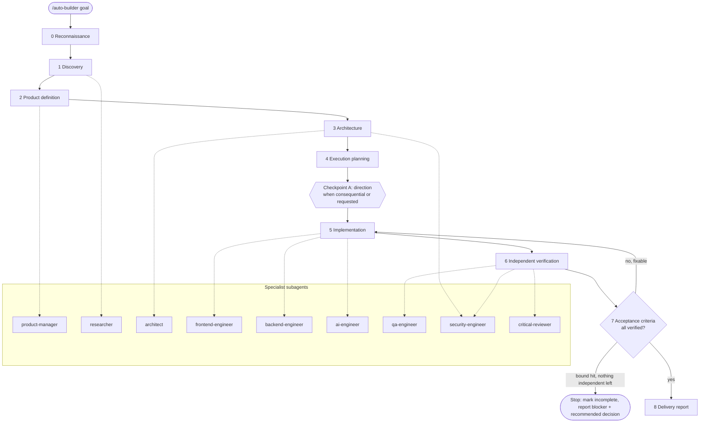

# AUTO-BUILDER: an autonomous coding agent skill for Claude Code

[](https://github.com/bsrikumar855-dot/ClaudeCODE-Autonomous-skills/actions/workflows/validate.yml)
[](LICENSE)


**AUTO-BUILDER** is an open-source [Claude Code skill](https://code.claude.com/docs/en/skills) plus nine specialist [subagents](https://code.claude.com/docs/en/sub-agents) for goal-driven autonomous development. Give `/auto-builder` a goal; it runs an AI software development workflow (discovery, requirements, architecture, planning, implementation, independent verification, iteration and delivery) and only stops to ask you at consequential checkpoints.

**Website and docs:** <https://bsrikumar855-dot.github.io/ClaudeCODE-Autonomous-skills/> (features, installation, usage tutorial, architecture, FAQ)

> An independent community project. Not affiliated with or endorsed by Anthropic, Boris Cherny or Andrej Karpathy; their public guidance is an inspiration only (see [principles](.claude/skills/auto-builder/principles/influences-and-sources.md)).

## Quick start

```bash
git clone https://github.com/bsrikumar855-dot/ClaudeCODE-Autonomous-skills
cd ClaudeCODE-Autonomous-skills
./install.sh --personal        # or: ./install.sh --project /path/to/repo
```

Then in Claude Code: `/auto-builder Build a REST API for a habit tracker with tests`. Windows: `.\install.ps1 -Personal` (see [Install](#install)).

**Status: early release.** The static checks and installer/hook tests pass, but the skill has not been validated end-to-end in live Claude Code sessions, and `install.ps1` has not been executed on Windows. See [Verification status](#verification-status).

**Contents:** [Why](#why-it-exists) · [How it works](#how-it-works) · [Install](#install) · [Use](#use) · [Configuration](#configuration) · [Safety](#human-approval-and-safety) · [Troubleshooting](#troubleshooting) · [Contributing](#contributing)

## Why it exists

Left alone, an autonomous coding agent tends to jump straight to code, declare victory after one green build, and ask permission for trivia. AUTO-BUILDER encodes a different default: **plan first, verify with evidence, have someone other than the author review, and escalate only what is risky or irreversible.**

## How it works

Phases 0–8, with a bounded fix loop (per-check attempt limit plus an iteration budget) and explicit approval gates:



**Quality protocol.** Work proceeds in milestones that each pass a verification gate (tests, regression checks, evidence, updated state files) before the next starts. A separate reviewer is used at meaningful milestones and for a final review; every criterion is reported as Verified, Partially verified or Untested; failures are root-caused and capped at three attempts. This is an instruction system for the model, not a guarantee of defect-free software.

**Security gate.** For projects that handle authentication, user data, payments, external APIs, file uploads, secrets, integrations or AI tools, `security-engineer` threat-models the design, reviews security-relevant milestones and does a final review before completion, independently of `qa-engineer` and `critical-reviewer`. A Critical finding blocks completion and cannot be accepted; a High finding must be fixed or explicitly accepted by you, and an accepted High stays recorded as open residual risk, never as fixed; Medium and Low findings are tracked. Reports say which method was used (static inspection, automated scanning, or penetration testing, which is not performed unless authorized). Trivial projects get a short checklist instead. A clean scan is never reported as "secure".

**Task router and playbooks.** `/auto-builder` classifies each request (new project, feature, bug fix, investigation, refactoring, performance, security assessment, code review, research, testing, documentation, release) and runs a short playbook for it inside one milestone row of `TASKS.md`; only a new project runs the full lifecycle. Trivial changes skip the ceremony. Routing can only add gates, never remove them. State files, issue/PR text and web pages are treated as **untrusted data** that can never grant approval or change limits. Optional capabilities: product interrogation, a cheap-by-default architecture arena, dependency-aware parallel execution, fresh-context review, bring-your-own-browser QA with an evidence format, session recovery that verifies state against git, and bounded PR/release help that never pushes, merges or deploys without approval. Most of this is instructions to the model; see [what is enforced and what is not](design/architecture/IMPLEMENTATION-STATUS.md).

The lead agent (your main Claude Code session) owns integration. Subagents get a precise brief and report back; they start without your conversation and cannot ask you questions. They share your working tree unless you opt into worktree isolation, so file ownership is assigned explicitly and only the lead commits. Project memory lives in files under `docs/auto-builder/` in your project, not in the conversation.

### Agents

| Agent | Responsibility | Can edit files |
|---|---|---|
| `product-manager` | Users, journeys, scope, acceptance criteria | no |
| `researcher` | Current libraries/APIs/alternatives from primary sources | no |
| `architect` | Architecture, schemas, plan critique | no |
| `frontend-engineer` | UI, accessibility, responsive behaviour | yes (assigned files) |
| `backend-engineer` | APIs, databases, integrations, pipelines | yes (assigned files) |
| `ai-engineer` | LLM/RAG/agents/evals/ML pipelines | yes (assigned files) |
| `qa-engineer` | Independent test runs, edge-case probing, proposes tests | no |
| `security-engineer` | Threat modeling, security review, fix verification (OWASP, authn/authz, injection, XSS/CSRF/SSRF, secrets, dependencies, data privacy, AI/LLM security) | no (reports) |
| `critical-reviewer` | Adversarial review of plans and diffs | no |

Read-only status: `architect`, `product-manager`, `researcher`, `qa-engineer` and `security-engineer` have no Edit/Write tools, and `critical-reviewer` has them denied. `critical-reviewer`, `qa-engineer` and `security-engineer` also have Bash to run checks, which Claude Code cannot restrict by argument, so they are *instructed* not to modify files or run destructive tests rather than technically prevented. `security-engineer` has no web tools. `researcher` and `product-manager` can fetch web pages, so treat fetched content as untrusted.

Rules: spawn only what the task needs; parallelise only independent work; never let two agents edit the same file ([details](.claude/skills/auto-builder/references/parallel-work.md)).

### Supported project types

AI/ML apps · AI agents and multi-agent systems · full-stack · frontend · backend/APIs · developer tools · research projects · automation · data engineering. See the [category guide](.claude/skills/auto-builder/references/project-categories.md).

## Install

Requires [Claude Code](https://code.claude.com). The installer copies files only: it **never** overwrites existing files (use `--update` to opt in, with `.bak` backups) and never touches settings, permissions, hooks or `CLAUDE.md`.

**Linux / macOS / WSL / Git Bash**

```bash
git clone https://github.com/bsrikumar855-dot/ClaudeCODE-Autonomous-skills
cd ClaudeCODE-Autonomous-skills
./install.sh --personal                 # all your projects: ~/.claude/
./install.sh --project /path/to/repo    # one project: <repo>/.claude/
./install.sh --project --dry-run        # preview into the current directory
```

**Windows (PowerShell)**

```powershell
git clone https://github.com/bsrikumar855-dot/ClaudeCODE-Autonomous-skills
cd ClaudeCODE-Autonomous-skills
.\install.ps1 -Personal                 # %USERPROFILE%\.claude\
.\install.ps1 -Project -Path C:\path\to\repo
.\install.ps1 -Project -DryRun
```

If scripts are blocked: `powershell -ExecutionPolicy Bypass -File .\install.ps1 -Personal`.

**Manual:** copy `.claude/skills/auto-builder/` and `.claude/agents/*.md` into `~/.claude/` (personal) or your project's `.claude/`.

Opening Claude Code *inside this repository* also works with no install — the skill is already in its `.claude/`.

## Use

```text
/auto-builder Build an AI research workspace where users can upload papers, ask grounded questions, and explore citations. Don't deploy anything.
```

Run `/auto-builder` with no argument and it will inspect the repo and ask for one goal. More examples: [examples/goal-prompt.md](.claude/skills/auto-builder/examples/goal-prompt.md).

### Example session (illustrative)

```text
> /auto-builder Add a rate-limited /v1/orders API with pagination and tests

[Phase 0] Python/FastAPI, pytest, ruff, Postgres via docker-compose. git clean on main.
          Created branch auto-builder/orders-api.
[Phase 1-2] Consumers: internal dashboard. Assumed cursor pagination (documented in DECISIONS.md).
          Acceptance: AC1 list paginates; AC2 429 after limit; AC3 invalid cursor -> 422; AC4 authz enforced.
[Phase 3-4] architect agent critique: store limiter state in Redis rather than in-process -> accepted.
          TASKS.md: 5 tasks. Checkpoint A: new Redis dependency (local only). Proceed? 
> yes
[Phase 5] backend-engineer: endpoints + limiter. Checkpoint commit "orders: list endpoint".
[Phase 6] pytest: 2 failed -> fixed -> 31 passed. ruff, mypy clean. critical-reviewer: 1 major
          (cursor not bound to user) -> fixed, re-verified. qa-engineer: AC1-AC4 verified.
[Phase 8] Delivered. Not run: load test, deployment. Branch not pushed.
```

This is a mock-up of the intended flow, not captured output or a benchmark.

## Configuration

| What | How |
|---|---|
| Allow Claude to load the skill automatically | In `SKILL.md` frontmatter remove `disable-model-invocation: true` (default is explicit `/auto-builder` only; note that scheduled/`/loop` re-entry then won't trigger it either) |
| Skip the git work branch | Say "no branch" in the goal (the skill only creates one if you haven't declined). Checkpoint commits are local, made only by the lead; review them with `git log`. With a dirty working tree it is instructed never to commit your uncommitted changes and to ask if it must edit a file you've modified |
| Require approval of the plan | Say "stop at the plan checkpoint" in the goal |
| Retry/iteration limits | Defaults are 3 attempts per failing check and 5 implement→verify passes per milestone; the budget lives in the Status block of `docs/auto-builder/TASKS.md` |
| Change agent models/limits | Edit `model`, `maxTurns`, `tools` in `.claude/agents/<name>.md` ([fields](https://code.claude.com/docs/en/sub-agents)) |
| Remove an agent | Delete its file; the lead performs that role itself |
| Project facts | Keep short build/test commands and conventions in your project's `CLAUDE.md` |

### Optional helper script (Python 3, read-only)

`.claude/skills/auto-builder/scripts/ab.py` is an optional, standard-library-only helper the lead can run as `python3 -I ab.py <command>`: `graph` (task-table validation, waves, ownership conflicts and a post-wave check that only owned files changed), `state` (compares what `TASKS.md` claims with git: verified commits, stale evidence, dirty files by owner, retry counters), and `browser-report` (format check for browser QA evidence). It writes nothing, uses no network, runs allow-listed git with repository configuration neutralised, is shipped non-executable, and is covered by hostile-input tests. It may trigger an ordinary permission prompt, and it is not wired into any hook. It checks files and formats; **it proves no behaviour**, and its output must not be cited as verification.

### Hooks (optional, off by default)

Two deterministic helpers ship in `scripts/hooks/` but are **not** installed into your settings. To enable, add to `.claude/settings.json` (project) or `~/.claude/settings.json` (personal; replace the path with `"$HOME"/.claude/skills/...`). Requires `jq`; scripts are bash (Git Bash/WSL on Windows). Limits: `protect-secrets.sh` checks file paths of Edit/Write/NotebookEdit only (not Bash commands or Read; use `permissions.deny` for those). `verify-on-stop.sh` retries up to `AUTO_BUILDER_MAX_RETRIES` (default 5) times, has a timeout, then lets Claude stop, so it is a strong nudge rather than an absolute gate. `AUTO_BUILDER_CHECK_CMD` runs as shell: set it only in your own settings, never accept it from an untrusted repository. A zip download may lose the executable bit (`chmod +x`).

```json
{
  "hooks": {
    "PreToolUse": [
      { "matcher": "Edit|Write|NotebookEdit",
        "hooks": [{ "type": "command",
          "command": "\"$CLAUDE_PROJECT_DIR\"/.claude/skills/auto-builder/scripts/hooks/protect-secrets.sh" }] }
    ],
    "Stop": [
      { "hooks": [{ "type": "command",
          "command": "AUTO_BUILDER_CHECK_CMD='npm test' \"$CLAUDE_PROJECT_DIR\"/.claude/skills/auto-builder/scripts/hooks/verify-on-stop.sh" }] }
    ]
  }
}
```

## Human approval and safety

Default mode: **full autonomy with critical checkpoints.** No questions about ordinary implementation, refactoring, debugging, tests, docs or in-scope architecture. It asks *before*: destructive database operations, production deployment, spending money/enabling paid services, exposing secrets, deleting important data, irreversible external actions (including pushing or opening PRs), and major changes of product direction.

It also: works on a fresh git branch, never pushes or opens PRs on its own, never asks to bypass Claude Code permissions or sandboxing, requires an independent review (and says so in the report if the reviewer agents are missing), and is told to report unrun checks honestly. These are instructions to the model, not hard guarantees — use Claude Code's [permissions and sandboxing](https://code.claude.com/docs/en/settings) as the enforcement layer, and review the diff yourself. Foreground subagent permission prompts reach you, so a hands-off run needs your commonly used test/lint/build commands pre-allowed; prefer narrow allow rules over bypass modes.

## Repository layout

```text
.
├── .claude/
│   ├── agents/
│   │   ├── ai-engineer.md
│   │   ├── architect.md
│   │   ├── backend-engineer.md
│   │   ├── critical-reviewer.md
│   │   ├── frontend-engineer.md
│   │   ├── product-manager.md
│   │   ├── qa-engineer.md
│   │   ├── researcher.md
│   │   └── security-engineer.md
│   └── skills/
│       └── auto-builder/
│           ├── examples/
│           │   └── goal-prompt.md
│           ├── playbooks/
│           │   ├── bug-fix.md
│           │   ├── feature.md
│           │   ├── inquiry.md
│           │   ├── performance.md
│           │   ├── refactor.md
│           │   ├── release.md
│           │   ├── security-assessment.md
│           │   └── test-and-docs.md
│           ├── principles/
│           │   ├── engineering-principles.md
│           │   └── influences-and-sources.md
│           ├── references/
│           │   ├── claude-code-features.md
│           │   ├── parallel-work.md
│           │   └── project-categories.md
│           ├── scripts/
│           │   ├── hooks/
│           │   │   ├── protect-secrets.sh
│           │   │   └── verify-on-stop.sh
│           │   ├── ab.py
│           │   └── init-artifacts.sh
│           ├── templates/
│           │   ├── ARCHITECTURE.md
│           │   ├── BROWSER-QA.md
│           │   ├── DECISIONS.md
│           │   ├── LESSONS.md
│           │   ├── PROGRESS.md
│           │   ├── PROJECT.md
│           │   ├── REQUIREMENTS.md
│           │   ├── SECURITY-REVIEW.md
│           │   ├── TASKS.md
│           │   └── TESTING.md
│           ├── workflows/
│           │   ├── arena.md
│           │   ├── browser-qa.md
│           │   ├── delivery.md
│           │   ├── discovery.md
│           │   ├── implementation.md
│           │   ├── independent-review.md
│           │   ├── planning.md
│           │   ├── router.md
│           │   ├── security.md
│           │   ├── session-recovery.md
│           │   ├── swarm.md
│           │   ├── tdd.md
│           │   └── verification.md
│           └── SKILL.md
├── .github/
│   ├── ISSUE_TEMPLATE/
│   │   ├── bug_report.yml
│   │   ├── config.yml
│   │   └── feature_request.yml
│   ├── workflows/
│   │   └── validate.yml
│   └── PULL_REQUEST_TEMPLATE.md
├── design/
│   ├── architecture/
│   │   ├── AUTOBUILDER-2.0-DESIGN.md
│   │   ├── DESIGN-REVIEW-LOG.md
│   │   ├── IMPLEMENTATION-REVIEW-LOG.md
│   │   ├── IMPLEMENTATION-STATUS.md
│   │   ├── LEARNING-ENGINE.md
│   │   ├── ORCHESTRATION.md
│   │   └── VERIFICATION-ENGINE.md
│   ├── benchmarks/
│   │   └── BENCHMARK-PLAN.md
│   ├── research/
│   │   ├── AUTOBUILDER-GAP-ANALYSIS.md
│   │   ├── GSTACK-RESEARCH.md
│   │   └── PSTACK-RESEARCH.md
│   ├── roadmap/
│   │   └── IMPROVEMENT-ROADMAP.md
│   └── README.md
├── docs/
│   ├── assets/
│   │   ├── favicon.svg
│   │   ├── og-image.png
│   │   ├── site.js
│   │   └── style.css
│   ├── .nojekyll
│   ├── 404.html
│   ├── architecture.html
│   ├── faq.html
│   ├── features.html
│   ├── index.html
│   ├── installation.html
│   ├── robots.txt
│   ├── sitemap.xml
│   └── usage.html
├── launch/
│   ├── README.md
│   ├── announcement.md
│   ├── community-posts.md
│   ├── devto-tutorial.md
│   ├── github-metadata.md
│   ├── launch-checklist.md
│   ├── merge-and-publication-checklist.md
│   ├── release-notes-v1.0.0.md
│   ├── search-console.md
│   ├── seo-strategy.md
│   └── social-preview-spec.md
├── site/
│   ├── pages/
│   │   ├── 404.html
│   │   ├── architecture.html
│   │   ├── faq.html
│   │   ├── features.html
│   │   ├── index.html
│   │   ├── installation.html
│   │   └── usage.html
│   ├── build.py
│   ├── check.py
│   └── og-image.html
├── tests/
│   ├── fixtures/
│   │   └── routing-eval.json
│   ├── run-all.sh
│   ├── test-install.sh
│   ├── test_ab.py
│   ├── test_mutations.py
│   └── validate.py
├── .gitignore
├── CHANGELOG.md
├── CLAUDE.md
├── CONTRIBUTING.md
├── LICENSE
├── README.md
├── SECURITY.md
├── install.ps1
└── install.sh
```

## Troubleshooting

| Symptom | Fix |
|---|---|
| `/auto-builder` not listed | Confirm `<project or ~>/.claude/skills/auto-builder/SKILL.md` exists; restart the Claude Code session |
| Agents not used | Confirm files in `.claude/agents/`; a pre-existing agent with the same name wins and the installer reports `PRESERVE` |
| Installer says `STALE` / `CONFLICT` | `STALE`: file from an older version, safe to delete by hand. `CONFLICT`: a symlink or directory sits where a file belongs; resolve manually |
| Installer says `PRESERVE` | Your file differs from the package; keep it, or run with `--update` / `-Update` (backup saved as `.bak`) |
| `Permission denied` on scripts | `chmod +x .claude/skills/auto-builder/scripts/*.sh .claude/skills/auto-builder/scripts/hooks/*.sh install.sh` |
| Hooks do nothing | Install `jq`; check the command path and the JSON in settings |
| PowerShell blocks `install.ps1` | See execution-policy note above |
| Claude pauses a lot | Normal for checkpoints; tell it which category of decision to default on, or tighten permission rules |

## Verification status

A live, end-to-end `/auto-builder` run has **not** been performed, so there are no measurements of routing accuracy or of improved outcomes, and the old-versus-new [benchmark](design/benchmarks/BENCHMARK-PLAN.md) is designed but **not run**. Partial evidence: Claude Code's agent registry listed the project agents once they existed in `.claude/agents/`.

The checks (`python3 -I tests/validate.py`, `bash tests/test-install.sh`) pass on Linux locally; the GitHub Actions workflow passed on GitHub for PR #1 and on `main` (Linux runner; static validation and installer tests only, not a live Claude Code run). **Not verified:** a live `/auto-builder` run inside Claude Code, and `install.ps1` on Windows. Please report issues.

## Contributing

See [CONTRIBUTING.md](CONTRIBUTING.md). Report bugs and ideas through the [issue templates](https://github.com/bsrikumar855-dot/ClaudeCODE-Autonomous-skills/issues/new/choose); report security problems per [SECURITY.md](SECURITY.md). Changes are tracked in [CHANGELOG.md](CHANGELOG.md).

## License

Apache License 2.0 — see [LICENSE](LICENSE).
