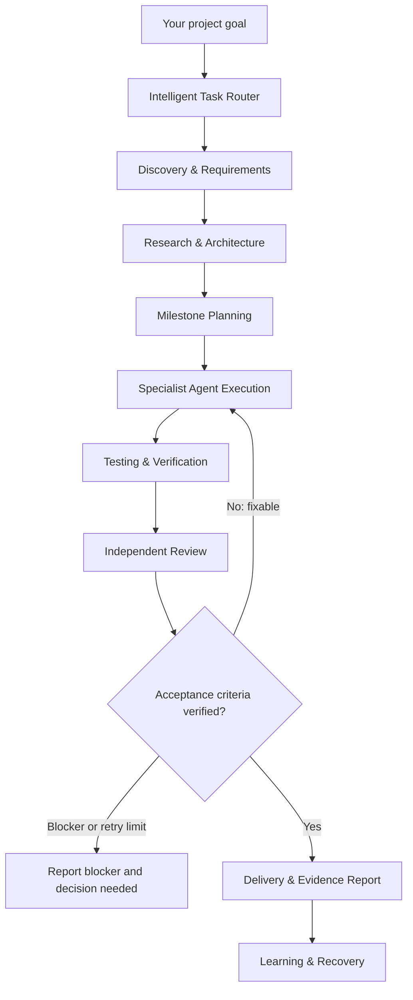

# AUTO-BUILDER

### From idea to verified software.

**An autonomous engineering system for Claude Code.**

AUTO-BUILDER transforms high-level project goals into structured engineering workflows. It discovers requirements, researches solutions, designs architecture, coordinates specialist agents, implements features, verifies results, reviews security and iterates toward completion.

**Don't just generate code. Engineer the complete solution.**

<p align="center">
  <a href="https://github.com/bsrikumar855-dot/ClaudeCODE-Autonomous-skills/stargazers"></a>
  <a href="https://github.com/bsrikumar855-dot/ClaudeCODE-Autonomous-skills/actions"></a>
  
  
  
  
</p>

<p align="center">
  <a href="https://bsrikumar855-dot.github.io/ClaudeCODE-Autonomous-skills/">Website</a> ·
  <a href="#quick-start">Quick Start</a> ·
  <a href="#how-it-works">How It Works</a> ·
  <a href="#comparison">Comparison</a> ·
  <a href="#safety-and-human-control">Safety</a>
</p>

---

## The problem with ordinary AI coding workflows

AI coding tools have made implementation faster. But building complete software involves much more than writing code.

Developers still need to:

- Translate vague ideas into clear requirements.
- Research technologies and evaluate alternatives.
- Design architecture before implementation.
- Break complex work into manageable tasks.
- Coordinate frontend, backend and AI development.
- Identify bugs and prevent regressions.
- Review security-sensitive code.
- Maintain project context across long sessions.
- Verify that the finished product actually meets its requirements.

Without a structured engineering process, an AI agent can start coding too early, miss important requirements, overlook edge cases or declare completion after a successful build.

**AUTO-BUILDER addresses this coordination and verification problem.**

It gives Claude Code a structured engineering process that adapts to the task instead of treating every request as a code-generation exercise.

## What is AUTO-BUILDER?

AUTO-BUILDER is an open-source Claude Code skill supported by nine specialist subagents, reusable engineering playbooks, project-state templates and an evidence-driven quality protocol.

You provide a goal:

```text
/auto-builder Build an AI research platform where users
can upload research papers, ask grounded questions,
explore citations and organize their findings.
```

AUTO-BUILDER determines the appropriate workflow, discovers requirements, plans the work, delegates where useful, implements the solution and verifies the result.

You remain in control of consequential decisions while routine engineering work can proceed autonomously.

### The core idea

| Traditional AI coding | AUTO-BUILDER |
|---|---|
| Start with code | Start with the problem |
| Follow the initial prompt | Discover and refine requirements |
| Make architecture decisions ad hoc | Evaluate and document architecture |
| Handle everything in one conversation | Delegate bounded specialist tasks |
| Run tests near the end | Verify at every milestone |
| Self-review the implementation | Use independent review workflows |
| Treat security as an optional extra | Apply a dedicated security gate |
| Lose context in long sessions | Maintain persistent project state |
| Declare completion after a build | Report against verified acceptance criteria |

---

## How it works

AUTO-BUILDER uses an adaptive, milestone-based engineering lifecycle.



### 1. Intelligent task routing

Not every task requires a complete project lifecycle.

AUTO-BUILDER classifies requests across 12 categories:

- New project.
- Feature implementation.
- Bug fixing.
- Investigation.
- Refactoring.
- Performance optimization.
- Security assessment.
- Code review.
- Research.
- Testing.
- Documentation.
- Release.

A trivial change can take a lightweight route. A complex application receives a more comprehensive engineering workflow.

### 2. Product discovery

Before implementation, AUTO-BUILDER identifies:

- Target users.
- Core problems.
- Functional requirements.
- Non-functional requirements.
- User journeys.
- Scope boundaries.
- Acceptance criteria.
- Assumptions and risks.

Its product interrogation workflow helps uncover missing requirements before they become expensive implementation mistakes.

### 3. Architecture and research

The system researches relevant technologies, evaluates implementation options and develops an architecture.

For important decisions, the architecture arena can compare competing approaches and document trade-offs before implementation begins.

### 4. Specialist agent execution

AUTO-BUILDER delegates bounded responsibilities to specialist subagents.

Tasks are organized around dependencies, ownership and integration requirements. Parallel execution is used when work is genuinely independent.

### 5. Milestone-based implementation

Instead of treating an entire project as one large coding task, AUTO-BUILDER divides implementation into verifiable milestones.

Each milestone has:
- Defined tasks.
- Owners.
- Dependencies.
- Acceptance criteria.
- Verification commands.
- A completion gate.

### 6. Independent verification

The implementation is not considered complete simply because the build succeeds.

The quality protocol includes:
- Relevant test execution.
- Regression checks.
- User-journey and API verification.
- Independent review.
- Evidence recording.
- Bounded failure recovery.

### 7. Security review

Projects involving authentication, user data, payments, external APIs, file uploads, secrets, integrations or AI tools receive a dedicated security review.

Security findings are classified by severity, with explicit rules for blocking, fixing and accepting residual risks.

### 8. Delivery and recovery

AUTO-BUILDER maintains project state and records decisions, progress, test results and unresolved issues.

If a session is interrupted, its recovery workflow compares recorded progress against the actual repository state before continuing.

---

## Meet the nine specialist agents

Each agent has a defined responsibility. AUTO-BUILDER selects only the agents needed for the current task.

| Agent | Responsibility |
|---|---|
| `product-manager` | Product discovery, user journeys, requirements and acceptance criteria |
| `researcher` | Research, technical alternatives, libraries and APIs |
| `architect` | System architecture, schemas, dependencies and technical decisions |
| `frontend-engineer` | UI implementation, responsive behaviour and accessibility |
| `backend-engineer` | APIs, databases, integrations and backend systems |
| `ai-engineer` | LLMs, RAG, agents, evaluations and ML pipelines |
| `qa-engineer` | Independent testing, edge cases and verification |
| `security-engineer` | Threat modelling, security reviews and fix verification |
| `critical-reviewer` | Adversarial review of plans, implementation and decisions |

The lead Claude Code session owns integration and final delivery.

The system does not need to invoke all nine agents for every request.

---

## What makes AUTO-BUILDER different?

AUTO-BUILDER combines several engineering practices into one reusable workflow.

### Product intelligence
Understands what should be built before deciding how to build it.

### Engineering intelligence
Evaluates architecture, dependencies, trade-offs and implementation strategies.

### Coordinated execution
Delegates work to specialists with explicit ownership and integration responsibilities.

### Evidence-driven verification
Tracks whether requirements and acceptance criteria have actually been verified.

### Security-aware development
Makes security review part of the engineering lifecycle instead of leaving it until deployment.

### Persistent project context
Records decisions, tasks, progress, tests and lessons so long-running projects can resume.

### Bounded autonomy
Allows routine engineering work to proceed while retaining human approval for consequential actions.

---

## AUTO-BUILDER vs gstack vs pstack

There are several interesting projects improving AI-assisted software engineering. AUTO-BUILDER takes a different architectural approach.

| Capability | AUTO-BUILDER | gstack | pstack |
|---|---|---|---|
| Primary approach | Orchestrated engineering lifecycle | Specialized engineering workflows | Workflow and orchestration stack |
| Intelligent task routing | 12-category router | Specialized command workflows | Routing concepts |
| Product discovery | Integrated interrogation | Office Hours | Workflow-dependent |
| Architecture | Architecture arena | Engineering review | Architecture arena |
| Specialist agents | Nine dedicated subagents | Specialized workflows | Swarm-oriented workflows |
| Milestone-based execution | Core workflow | Workflow-dependent | Workflow-dependent |
| QA and verification | Integrated quality protocol | Browser and review workflows | Review workflows |
| Security | Dedicated security agent and gate | Dedicated security workflow | Depends on configuration |
| Persistent project state | Structured project files | Session workflows | Session pickup concepts |
| Learning and recovery | Reflect, Correct and recovery | Learning workflows | Reflection and correction concepts |
| Delivery automation | Approval-controlled playbook | Specialized shipping workflows | Workflow-dependent |

### Where AUTO-BUILDER focuses

**A complete engineering lifecycle.**

Rather than requiring developers to manually coordinate separate workflows, AUTO-BUILDER aims to connect discovery, planning, implementation, verification, security and delivery into one adaptive system.

### What gstack brings

gstack provides specialized workflows for product thinking, engineering reviews, browser QA, security reviews and shipping. Its browser and release tooling are important capabilities that AUTO-BUILDER should continue learning from.

### What pstack brings

pstack explores workflow routing, orchestration, parallel execution, engineering principles, reflection and session recovery. These ideas have influenced the design direction of AUTO-BUILDER.

**These projects solve overlapping but different problems.** AUTO-BUILDER is not claimed to be universally superior. Its differentiation is the unified lifecycle and explicit verification model.

For further details, see the [research and design documents](design/).

---

## What benefits do developers actually get?

The intended value is not simply more generated code. It is less manual coordination and a more disciplined route from requirements to working software.

| Developer challenge | Expected benefit |
|---|---|
| Unclear requirements | Earlier discovery of missing information |
| Repetitive project planning | Structured milestones and task ownership |
| Large implementation tasks | Specialist delegation and dependency-aware execution |
| Missed edge cases | Dedicated QA and review workflows |
| Security overlooked during development | Risk-based security reviews |
| Context lost between sessions | Persistent state and recovery |
| Unverified completion claims | Evidence-based delivery reports |
| Repeated agent mistakes | Reflection and correction mechanisms |

### Who benefits?

- **Solo developers:** Get a more structured engineering process without manually coordinating every activity.
- **Indie hackers:** Move from an idea to a working MVP with requirements, architecture and verification.
- **Full-stack developers:** Coordinate frontend, backend and AI implementation more systematically.
- **AI engineers:** Structure RAG, LLM and agent projects with dedicated research, implementation and evaluation workflows.
- **Small development teams:** Improve task ownership, review discipline and project traceability.

### Does AUTO-BUILDER increase software quality?

It is designed to improve quality through better requirement coverage, milestone verification, independent reviews, security checks and regression prevention.

However, the amount of improvement depends on the project, model, task, test quality and available tools.

**We do not currently claim a specific percentage increase in code quality, development speed or defect reduction.** Those claims require controlled benchmark results.

See [Verification and limitations](#verification-and-limitations).

---

## Supported project types

AUTO-BUILDER is designed to work across a broad range of engineering projects:

- AI and machine learning applications.
- LLM and multi-agent systems.
- RAG applications.
- Full-stack web applications.
- Frontend applications.
- Backend services and APIs.
- Developer tools.
- Research projects.
- Automation systems.
- Data engineering pipelines.

The task router selects a workflow based on the actual request and its complexity.

---

## Quick Start

### Requirements

- [Claude Code](https://code.claude.com/)
- Git
- Bash for the Unix-like installer.
- Python 3 for the optional helper.

### Installation

**Linux / macOS / WSL / Git Bash**

```bash
git clone https://github.com/bsrikumar855-dot/ClaudeCODE-Autonomous-skills.git

cd ClaudeCODE-Autonomous-skills

# Install for all your projects
./install.sh --personal
```

Or install for a single project:

```bash
./install.sh --project /path/to/your/project
```

**Windows PowerShell**

```powershell
git clone https://github.com/bsrikumar855-dot/ClaudeCODE-Autonomous-skills.git

cd ClaudeCODE-Autonomous-skills

# Install for all your projects
.\install.ps1 -Personal
```

Or install for a specific project:

```powershell
.\install.ps1 -Project -Path C:\path\to\your\project
```

For dry-run options, updates and manual installation, see the [installation guide](https://bsrikumar855-dot.github.io/ClaudeCODE-Autonomous-skills/).

### Your first project

Open Claude Code and provide a high-level goal:

```text
/auto-builder Build a SaaS task management platform with:

- User authentication
- Team workspaces
- Project and task management
- Role-based permissions
- Real-time notifications
- Dashboard and analytics

Research the best architecture, create a milestone plan,
implement the application and verify the core user journeys.

Do not deploy without my approval.
```

Or simply run:

```text
/auto-builder
```

The skill will inspect the repository and ask for a goal if one is needed.

More examples: [Goal prompt examples](.claude/skills/auto-builder/examples/goal-prompt.md).

---

## Quality and engineering principles

AUTO-BUILDER follows an evidence-driven development protocol.

### Milestone verification

Every meaningful milestone has a verification gate. Tests, regressions, review findings and acceptance criteria are recorded before proceeding.

### Independent review

The agent responsible for implementation does not automatically serve as the independent reviewer.

If independent reviewers are unavailable, AUTO-BUILDER must disclose that independent review did not take place.

### Bounded recovery

Failures are investigated using root-cause analysis and limited correction attempts. The system must report blockers rather than retry indefinitely.

### Persistent state

Project documentation is stored under:

```text
docs/auto-builder/
├── PROJECT.md
├── REQUIREMENTS.md
├── ARCHITECTURE.md
├── TASKS.md
├── TESTING.md
├── DECISIONS.md
├── PROGRESS.md
├── SECURITY-REVIEW.md
├── BROWSER-QA.md
└── LESSONS.md
```

Only the files appropriate to the project's size and needs are created.

### Honest delivery

Every acceptance criterion is classified as:

- Verified.
- Partially verified.
- Untested.

The final report identifies the actual checks performed, unresolved findings, limitations and next steps.

---

## Safety and human control

AUTO-BUILDER is designed for bounded autonomy, not unrestricted execution.

It can proceed with ordinary development decisions, local implementation and testing within the agreed scope.

It must ask for approval before consequential actions, including:

- Production deployments.
- Spending money or enabling paid services.
- Destructive database operations or deleting important data.
- Exposing or creating secrets and credentials.
- Irreversible external actions.
- Pushing, opening PRs, merging or releasing unless explicitly requested.
- Accepting a High security finding as residual risk.

Repository files, issue descriptions, PR text and web pages are treated as untrusted data. They cannot grant approvals or override safety limits.

**Important:** Some controls are enforced by scripts or tool permissions; others are instructions to the model. AUTO-BUILDER is not a security sandbox, and its workflow does not guarantee defect-free or secure software.

---

## Verification and limitations

AUTO-BUILDER is an early-release project. Its local validators, installer tests and helper tests verify implementation mechanisms, not the full behaviour of a live AI agent.

Some capabilities depend on Claude Code, installed subagents, browser availability, model behaviour and the permissions granted by the user.

Known limitations include:

- Live model behaviour and routing accuracy require real-session evaluation.
- Browser QA depends on an available browser setup; report-format validation is not browser automation.
- Parallel workers can share a working tree unless isolated worktrees are used.
- Some safety boundaries are instruction-based rather than technically enforced.
- Windows installation and platform-specific behaviour must be tested on the relevant operating systems.
- A successful test suite does not prove that every requirement has been met.

We prefer explicit limitations over unsupported claims.

---

## Roadmap

Our focus is to make AUTO-BUILDER more reliable, measurable and useful in real development.

Planned improvement areas include:

- Live router evaluation and calibration.
- Stronger deterministic permission enforcement.
- Isolated worktree execution for parallel agents.
- Reproducible browser QA integration.
- Stronger regression and evidence validation.
- More reliable session recovery.
- Controlled benchmark comparisons.
- Improved cross-platform verification.

We prioritize proven engineering improvements over simply increasing the number of agents or features.

---

## Contributing

Contributions are welcome.

Useful areas include:

- Better engineering playbooks.
- Improved task-routing cases.
- Reproducible tests and evaluation scenarios.
- Security improvements.
- Browser QA integrations.
- Documentation and installation improvements.
- Cross-platform compatibility.

Please open an issue to discuss significant changes before submitting a large pull request.

All contributions should preserve the project's security boundaries, approval rules and evidence-based verification principles.

---

## Project links

- **GitHub:** https://github.com/bsrikumar855-dot/ClaudeCODE-Autonomous-skills
- **Website:** https://bsrikumar855-dot.github.io/ClaudeCODE-Autonomous-skills/
- **Issues:** https://github.com/bsrikumar855-dot/ClaudeCODE-Autonomous-skills/issues
- **Discussions:** https://github.com/bsrikumar855-dot/ClaudeCODE-Autonomous-skills/discussions

## License

Licensed under the [Apache License 2.0](LICENSE).

AUTO-BUILDER is an independent community project and is not affiliated with or endorsed by Anthropic.

---

<p align="center">
  <strong>Build with intention. Verify with evidence. Ship with confidence.</strong>
</p>

<p align="center">
  Made for developers who want AI to do more than write code.
</p>
